# 🇷🇼 Muraho Live 
### Real-Time AI Voice Translator & Cultural Copilot for Kigali, Rwanda
**Hacktoberfest Hack Day Kigali 2026 — Build54 × ALX × GDG Rwanda × MLH**

[](https://github.com/mathewkenyi07/muraho_live)
[](https://murahovoice.tech)
[-black?logo=next.js)](https://nextjs.org)
[-00A3E0?logo=pwa)](https://murahovoice.tech/manifest.json)
[](https://opensource.org/licenses/MIT)

**Muraho Live** is a real-time, low-latency multimodal voice copilot designed specifically for navigating Kigali, Rwanda. Whether you are negotiating a moto fare with a motari in Giporoso, bargaining for passion fruit and avocado in Kimironko Market, or paying via MTN Mobile Money (*182#), Muraho Live translates vernacular Kinyarwanda street speech, provides real-time fair price benchmarks, alerts you to Rwandan cultural etiquette and safety norms, and generates one-tap USSD payment payloads.

---

## 🏆 Hackathon Prize Tracks & Category Submissions

Muraho Live was built for **Hacktoberfest Hack Day Kigali 2026 (Build54 & ALX & GDG Rwanda)** and enters the following prize categories:

| Prize Track | Why Muraho Live Qualifies | Implementation Details |
| :--- | :--- | :--- |
| **Best Use of Gemma 4** | Uses open-weight multimodal intelligence for rapid prototyping and lightweight real-world community reasoning. | Harnesses Google Gemma & Gemini for colloquial Kinyarwanda vernacular slang understanding (`Bite se`, `wangu`, `gutwika`), Rwandan transport heuristics, and cultural safety advisories. |
| **Best Open-Source AI Project** | Fully open-source project (MIT licensed) adapting open-weight speech models for African low-resource languages. | Integrates Hugging Face open-weight Kinyarwanda models (`badrex/w2v-bert-2.0-kinyarwanda-asr` & `facebook/mms-tts-kin`) with an extensible local fallback harness. |

---

## ⚡ 2-Minute Pitch Script for Hackathon Judges

> *"Judges, in fast-growing African metropolises like Kigali, everyday street interactions happen in vibrant colloquial dialects and cashless USSD payment flows.*
>
> *Existing translation apps completely fail on the street. Standard translators only know textbook phrasing—they don't know Kigali street slang like 'Bite se motari' or 'ntwike ikirere', they don't know RURA-regulated transit fare brackets, and they can't construct the MTN MoMo USSD payment strings needed to settle up with drivers and market vendors.*
>
> *Enter **Muraho Live**. Built with Next.js 14 and powered by **Google Gemma / Gemini** for street slang reasoning, **ElevenLabs** for ultra-lifelike Kigali-accented voice output, and **Groq** for sub-150ms speech interpretation.*
>
> *Watch this: I tap the mic and say: 'Hey, I need to get from Kigali Downtown to Kigali Convention Centre. Ask the motari for a fair price.'*
>
> *Muraho Live immediately responds in vernacular Kinyarwanda: 'Bite se motari! Ndashaka kugera KCC. Mpa igiciro kizima bro.' At the same time, it pops up a Cultural Alert: 'Fair Fare Benchmark: 1,000 – 1,200 RWF. Do not pay more than 1,500 RWF! Always demand an Ingofero helmet.'*
>
> *When the ride ends, Muraho Live converts the agreed fare into a ready-to-dial `*182*8*1*CODE*1200#` MTN Mobile Money USSD code — eliminating payment friction across Africa's leading cashless city.*
>
> *And if the network drops in a rural valley? Muraho Live has pre-cached offline fail-safe scenarios for moto hailing, market bargaining, and emergency contacts.*
>
> *Muraho Live isn't just a language translator — it is your hyper-local cultural copilot. Thank you."*

---

## 🏗️ System Architecture

```mermaid
flowchart TD
    subgraph Client ["Client Layer (Mobile PWA / Web Audio)"]
        UI["Muraho Live UI (Next.js 14 / Tailwind CSS)"]
        MIC["AudioController (MediaStream & Analyser)"]
        ORB["VisualizerOrb (Dynamic Ambient State)"]
        HUD["CulturalHUD (Real-Time Safety & Fare Alerts)"]
        MOMO["MoMoModal (One-Tap USSD *182# Payment)"]
        FS["FailSafeDrawer (Offline Scenarios)"]
    end

    subgraph API ["Next.js API & Orchestration Layer"]
        TRANSCRIBE["/api/transcribe (Speech-to-Text)"]
        TRANSLATE["/api/translate (Cultural Dialect Translation)"]
        TTS["/api/tts-elevenlabs (Voice Synthesis)"]
        FARES["/api/fares (RURA Fare Matrix)"]
        MOCKS["/api/mock-scenarios (Acoustic Fail-Safe Engine)"]
        HEALTH["/api/health (Service Telemetry)"]
    end

    subgraph AI ["AI & Speech Models"]
        GEMINI["Google Gemini / Gemma (Vernacular Reasoning)"]
        EL["ElevenLabs (Low-Latency Neural Voice)"]
        GROQ["Groq LPU (Sub-150ms Translation)"]
        HF["Hugging Face (w2v-bert-2.0 & mms-tts-kin)"]
    end

    subgraph Services ["Cloud & Fintech Integrations"]
        TK["Tinker (Sandboxed Fare Calculations)"]
        BB["Backboard.io (Realtime State Sync)"]
        BS["Browserbase (RURA Fare Web Scraper)"]
        PI["Paper Instruments (MoMo USSD Formatter)"]
        DO["DigitalOcean (FastAPI Worker & Docker)"]
    end

    MIC -->|Captured Audio Blob| TRANSCRIBE
    TRANSCRIBE -->|Speech-to-Text| GEMINI
    TRANSCRIBE -->|Transcribed English/Kinyarwanda| TRANSLATE
    TRANSLATE -->|Colloquial Dialect & Heuristics| GEMINI
    TRANSLATE -->|Sub-150ms LPU Inference| GROQ
    TRANSLATE -->|Sanity Checks & Fare Benchmarks| TK
    TRANSLATE -->|Formatted USSD *182*8*1#| PI
    TRANSLATE -->|Voice Synthesis Stream| TTS
    TTS -->|Neural Voice Synthesis| EL
    TTS -.->|Open-Weight Model Fallback| HF

    TRANSLATE --> HUD
    TRANSLATE --> MOMO
    TTS --> ORB
    FS -.-> UI
```



---

## 🔑 Key Features

1. **Push-to-Talk & Live Audio Capture (`components/AudioController.tsx`)**
   - Captures microphone audio using the HTML5 `MediaRecorder` & `AudioContext` APIs.
   - Real-time frequency analyzer drives the dynamic pulsating visualizer orb.
   - Automatically posts audio blobs to `/api/transcribe` for instant speech-to-text.

2. **Multilingual Street Vernacular Engine (`app/api/translate/route.ts`)**
   - Translates spoken queries into natural, street-smart Kinyarwanda rather than robotic formal text.
   - Contextualizes Rwandan slang words (*bro*, *wangu*, *gutwika*, *ingofero*, *motari*).

3. **Cultural HUD & Transport Safety Alerts (`components/CulturalHUD.tsx`)**
   - **Ingofero Helmet Safety:** Prompts users to inspect driver-provided helmets.
   - **RURA Fare Regulations:** Automatically displays official price brackets for route pairs across Kigali.
   - **Market Etiquette Tips:** Explains cultural greeting norms (*Mwaramutse* / *Muraho*) that foster fair vendor relationships.

4. **1-Tap MTN Mobile Money (*182#) USSD Dialer (`components/MoMoModal.tsx`)**
   - Formats merchant codes directly into mobile-dialable USSD syntax: `*182*8*1*MERCHANT_CODE*AMOUNT#`.
   - Supports 1-click clipboard copy and direct mobile tel URI dialing (`tel:*182*8*1*...#`).

5. **Acoustic Fail-Safe Engine (`components/FailSafeDrawer.tsx`)**
   - Equipped with pre-cached audio and text dialogues for the 3 primary situations:
     - **Moto Ride:** Kigali Downtown to Kigali Convention Centre (KCC).
     - **Market Bargain:** Kimironko Market passion fruit (*marakuja*) purchase.
     - **MoMo Settlement:** End-of-ride mobile payment settlement.

---

## 🛠️ Tech Stack & Integrations

- **Frontend:** Next.js 14 (App Router), React 18, TypeScript, Tailwind CSS, Lucide Icons
- **Audio Engine:** Web Audio API (`AudioContext`, `AnalyserNode`, `MediaStream`)
- **AI Models:**
  - **Google Gemini 2.5 & Gemma:** Audio transcription, cultural nuance translation, and safety guardrails.
  - **ElevenLabs:** Low-latency neural voice synthesis (`eleven_multilingual_v2`).
  - **Groq LPU:** High-throughput sub-150ms translation inference.
  - **Hugging Face / Open-Source Models:** `badrex/w2v-bert-2.0-kinyarwanda-asr` & `facebook/mms-tts-kin`.
- **Infrastructure & Tools:**
  - **DigitalOcean & Docker:** Multi-stage production container and background worker.
  - **Backboard.io:** Session state synchronization.
  - **Browserbase:** Headless automated RURA fare scraping.
  - **Paper Instruments:** USSD fintech payload generation.

---

## 🚀 Getting Started

### Prerequisites
- Node.js `20.x` or later
- npm `10.x` or later (or Docker)

### 1. Clone the Repository
```bash
git clone https://github.com/mathewkenyi07/muraho_live.git
cd muraho_live
```

### 2. Install Dependencies
```bash
npm install
```

### 3. Configure Environment Variables
Copy `.env.example` to `.env.local`:
```bash
cp .env.example .env.local
```
Add your API keys to `.env.local`:
```env
# Google Gemini (STT & Multimodal Reasoning)
GEMINI_API_KEY=your_gemini_api_key_here

# ElevenLabs (Low-Latency Spoken Voice)
ELEVENLABS_API_KEY=your_elevenlabs_api_key_here
ELEVENLABS_VOICE_ID=your_voice_id_here

# Groq (Optional LPU Accelerator)
GROQ_API_KEY=your_groq_api_key_here
```
*(Note: Muraho Live includes built-in offline fallbacks and browser speech synthesis so the app remains interactive even without external keys!)*

### 4. Run the Development Server
```bash
npm run dev
```
Open [http://localhost:3000](http://localhost:3000) in your browser.

---

## 📡 API Endpoints

| Endpoint | Method | Description |
| :--- | :--- | :--- |
| `/api/transcribe` | `POST` | Accepts audio stream (`multipart/form-data` or base64 JSON) and transcribes spoken English/Kinyarwanda. |
| `/api/translate` | `POST` | Interprets street dialogue, applies cultural heuristics, calculates RURA fare brackets, and builds MoMo USSD strings. |
| `/api/tts-elevenlabs` | `POST` | Synthesizes high-fidelity Kigali-accented voice output. |
| `/api/fares` | `GET` | Returns landmark fare benchmarks and route distance matrices across Kigali. |
| `/api/mock-scenarios` | `POST` | Acoustic fail-safe simulator providing instant responses for demo scenarios. |
| `/api/health` | `GET` | Service telemetry and integration status health check. |

---

## 🐳 Docker Deployment

Build and run using the optimized multi-stage container:

```bash
# Build Docker image
docker build -t murahovoice:latest .

# Run container
docker run -d -p 3000:3000 --env-file .env.local --name muraho-app murahovoice:latest

# Verify health
curl http://localhost:3000/api/health
```

---

## 📱 Progressive Web App (PWA)

Muraho Live is fully configured as an installable mobile PWA:
- **Theme Color:** `#0F172A` (Slate 900 Kigali Night)
- **Display Mode:** `standalone` (Nav-free mobile experience)
- **Manifest:** Defined in [`public/manifest.json`](public/manifest.json) with high-res maskable icons.
- **Quick Shortcuts:** Instant 1-tap shortcuts for *Hail Motari*, *Kimironko Market*, and *Pay with MoMo*.

---

## 👥 Hackathon Team & Collaborators

- **Mathew Isaac** ([@mathewkenyi07](https://github.com/mathewkenyi07)) — Lead Developer
- **chiengkuach Aleer** ([@chiengkauchjok](https://github.com/chiengkauchjok)) — Collaborator
- **Daniel Ngaruka** ([@daniel7nrk](https://github.com/daniel7nrk)) — Collaborator
- **engjuleskad-sudo** ([@engjuleskad-sudo](https://github.com/engjuleskad-sudo)) — Collaborator
- **ladusatimonmusa** ([@ladusatimonmusa](https://github.com/ladusatimonmusa)) — Collaborator
- **Edson Ndyanabo** ([@ndyanaboeddy512-lgtm](https://github.com/ndyanaboeddy512-lgtm)) — Collaborator
- **Oleyo Nelson** ([@Onel45](https://github.com/Onel45)) — Collaborator

### Event & Community Partners
- **Event:** [Hacktoberfest Hack Day Kigali 2026](https://www.mlh.com/events/hacktoberfest-hack-day-kigali-x-build54-africa-foundation)
- **Partners:** Build54 Africa Foundation, ALX Rwanda, GDG Rwanda, and Major League Hacking (MLH).

---

## 📄 License

This project is licensed under the [MIT License](LICENSE). Built with ❤️ for Kigali, Rwanda.
