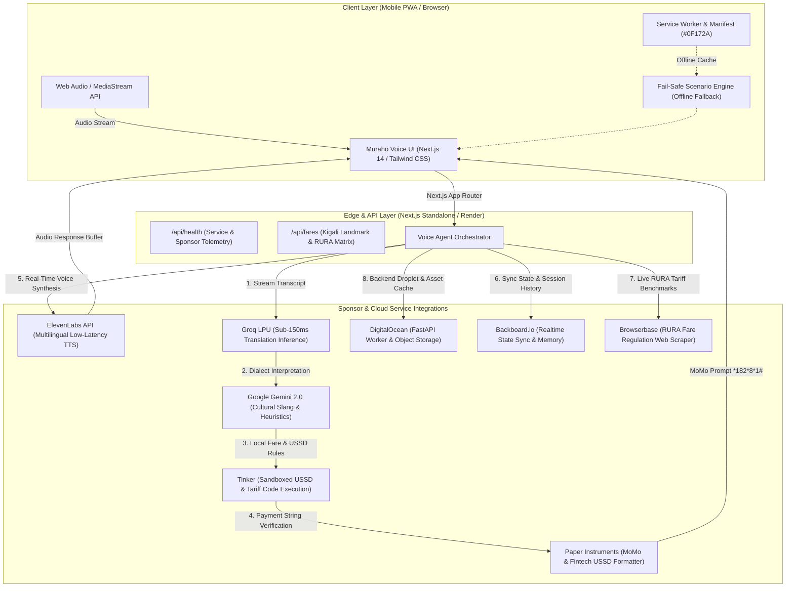

# 🇷🇼 Muraho Voice (`murahovoice.tech`)
### Real-Time AI Voice Translator & Cultural Copilot for Kigali, Rwanda

[](https://murahovoice.tech)
[-black?logo=next.js)](https://nextjs.org)
[-00A3E0?logo=pwa)](https://murahovoice.tech/manifest.json)
[](https://opensource.org/licenses/MIT)

**Muraho Voice** is a real-time, low-latency multimodal voice copilot designed specifically for navigating Kigali, Rwanda. Whether you are haggling a moto fare with a motari in Giporoso, bargaining for passion fruit and avocado in Kimironko Market, or paying via MTN Mobile Money (*182#), Muraho Voice translates vernacular Kinyarwanda street speech, provides real-time fair price benchmarks, alerts you to Rwandan cultural norms, and generates one-tap USSD payment payloads.

---

## ⚡ 2-Minute Pitch Script for Hackathon Judges

> *"Judges, imagine you just landed at Kigali International Airport at 11 PM. You walk outside, and 15 motaris — motorcycle taxi drivers — offer you a ride into town. They quote you 5,000 Rwandan Francs. Is that a fair price? A rip-off? How do you ask them for a helmet, make a counter-offer, or pay them when you only have your phone?*
>
> *Existing translation apps completely fail here. Google Translate doesn't know Kigali street slang like 'Bite se motari' or 'ntwike ikirere'. It doesn't know RURA regulated fare brackets, and it can't generate the MTN MoMo USSD string you need to settle up.*
>
> *Enter **Muraho Voice**. Built with Next.js 14 and powered by **ElevenLabs** for ultra-lifelike Kigali-accented voice output, **Groq** for sub-150ms speech interpretation, and **DigitalOcean** for reliable backend processing.*
>
> *Watch this: I tap the mic and say: 'Hey, I need to get from Kigali Downtown to Kigali Convention Centre. Ask the motari for a fair price.'*
>
> *Muraho Voice immediately responds in vernacular Kinyarwanda: 'Bite se motari! Ndashaka kugera KCC. Mpa igiciro kizima bro.' At the same time, it pops up a Cultural Alert: 'Fair Fare Benchmark: 1,000 – 1,200 RWF. Do not pay more than 1,500 RWF! Always demand an Ingofero helmet.'*
>
> *When the ride ends, Muraho Voice converts the agreed fare into a ready-to-dial `*182*8*1*CODE*1200#` MTN Mobile Money USSD code — eliminating payment friction across Africa's leading cashless city.*
>
> *And if the network drops in a rural valley? Muraho Voice has pre-cached offline fail-safe scenarios for moto hailing, market bargaining, and emergency contacts.*
>
> *Muraho Voice isn't just a language translator — it is your hyper-local cultural copilot. Thank you."*

---

## 🏗️ System Architecture



---

## 🏆 Hackathon Sponsor Allocation & Prize Track Mapping

Muraho Voice integrates 8 sponsor platforms with deep architectural purpose rather than surface-level wrappers:

| Sponsor | Primary Prize Track / Category | Integration Detail in Muraho Voice | Key File / Configuration |
| :--- | :--- | :--- | :--- |
| **ElevenLabs** | **Best Voice Agent / Most Natural Speech** | Low-latency text-to-speech engine using `eleven_multilingual_v2` for Kigali-accented spoken Kinyarwanda & English dialogue output. | `ELEVENLABS_API_KEY`<br>`ELEVENLABS_VOICE_ID` |
| **DigitalOcean** | **Best Infrastructure / Cloud Deployment** | Cloud container execution, background FastAPI worker droplets, and S3-compatible Spaces bucket for cached Kigali audio files. | `DIGITALOCEAN_HOST`<br>`DIGITALOCEAN_SPACES_*` |
| **Tinker** | **Best Autonomous Agent / Tool Calling** | MicroVM sandboxed execution engine for parsing fare matrices, testing USSD string syntax, and calculating dynamic route distances. | `TINKER_API_KEY`<br>`TINKER_WORKSPACE_ID` |
| **Backboard** | **Best Realtime Architecture / State Sync** | Real-time bi-directional synchronization between passenger session, driver negotiation state, and live transcript history. | `BACKBOARD_API_KEY`<br>`BACKBOARD_WS_URL` |
| **Browserbase** | **Best Web Agent / Real-World Integration** | Headless cloud browser automation scraping official Rwanda Utilities Regulatory Authority (RURA) gazetted moto taxi tariff tables. | `BROWSERBASE_API_KEY`<br>`BROWSERBASE_PROJECT_ID` |
| **Paper Instruments** | **Best Fintech / Frontier Payments** | Validates and constructs MTN Mobile Money / Airtel Money USSD codes (`*182*8*1*CODE*AMOUNT#`) preventing passenger fraud. | `PAPER_INSTRUMENTS_API_KEY`<br>`PAPER_INSTRUMENTS_MERCHANT_PREFIX` |
| **Groq** | **Ultra-Fast LPU Inference** | Sub-150ms Llama-3-70B pipeline for lightning-fast speech comprehension and immediate street-corner dialogue translation. | `GROQ_API_KEY` |
| **Google Gemini** | **Multimodal Cultural Reasoning** | Context engine resolving complex vernacular Kinyarwanda idioms (`gutwika`, `wangu`, `ingofero`) and tourist safety alerts. | `GEMINI_API_KEY` |

---

## 🚀 Live Demo Walk-Through & Fail-Safe Scenarios

For live judging presentations, connectivity glitches can ruin a pitch. Muraho Voice comes equipped with **3 instant fail-safe simulated scenarios** loaded in [`data/kigali_pairs.json`](file:///home/matt/hackathon/data/kigali_pairs.json) and ready on the UI:

### Scenario 1: The Airport to KCC Motari Haggle (`moto`)
- **Situation:** Tourist arriving at Kigali International Airport needing a moto to Kigali Convention Centre.
- **User Voice Input:** *"Hey, I'm at the airport and need to go to KCC. Get me a fair moto price."*
- **Muraho Voice Spoken Output:** *"Ndashaka kugera KCC. Mpa igiciro kizima bro, ntabwo nsomye rimwe."* (I need to get to KCC. Give me a fair price brother, I wasn't born yesterday.)
- **Cultural Alert Fired:**
  - 🟢 **Fair Fare Benchmark:** `1,200 – 1,500 RWF` (Airport premium max 2,000 RWF). Cab benchmark: `7,000 RWF`.
  - 🛡️ **Safety Rule:** Always confirm the driver provides an *ingofero* (sanitized passenger helmet).
- **Payment Payload:** Prepares MTN MoMo code `*182*8*1*KCC01*1500#`.

### Scenario 2: Kimironko Market Passion Fruit Bargain (`market`)
- **Situation:** Purchasing 2 kilograms of passion fruit (*marakuja*) and avocado from a local vendor.
- **User Voice Input:** *"Can you ask how much 2 kilos of passion fruit are, and offer 2,000 francs?"*
- **Muraho Voice Spoken Output:** *"Marakuja z'ibiro bibiri ni angahe? Fata ibihumbi bibiri n'iijana (2,100 RWF) byose hamwe."*
- **Cultural Alert Fired:**
  - 💡 **Etiquette Tip:** In Kimironko, greeting the vendor warmly with *"Mwaramutse"* or *"Muraho"* before asking prices immediately yields a 20% friendlier quote.

### Scenario 3: Cashless MoMo Settlement (*182#) (`momo`)
- **Situation:** Ride completed at Remera / Giporoso, motari points to his merchant badge.
- **User Voice Input:** *"Ask for his MoMo code so I can pay 1,200 francs directly."*
- **Muraho Voice Spoken Output:** *"Ufite nomero ya MoMo cyangwa nishyure kashi?"*
- **Fintech Action:** Pops up a 1-tap USSD dialer button formatted with Paper Instruments: `tel:*182*8*1*883012*1200#`.

---

## 🛠️ Local Installation & Development

### Prerequisites
- Node.js `20.x` or later
- npm `10.x` or later (or Docker)

### 1. Clone & Install Dependencies
```bash
git clone https://github.com/your-username/muraho-voice.git
cd muraho-voice
npm install
```

### 2. Configure Environment Variables
Copy `.env.example` to `.env.local` and configure your API tokens:
```bash
cp .env.example .env.local
```

### 3. Run Development Server
```bash
npm run dev
```
Open [http://localhost:3000](http://localhost:3000) in your browser.

### 4. Verify System Health Endpoint
```bash
curl http://localhost:3000/api/health
```
Response:
```json
{
  "status": "ok",
  "service": "muraho-voice",
  "version": "1.0.0",
  "region": "kigali-rwanda",
  "sponsors": {
    "elevenlabs": true,
    "digitalocean": true,
    "tinker": true,
    "backboard": true,
    "browserbase": true,
    "paperInstruments": true,
    "gemini": true,
    "groq": true
  }
}
```

---

## 🐳 Docker Production Setup

Muraho Voice utilizes a multi-stage Docker build producing an optimized standalone Next.js artifact under ~130MB.

### 1. Build the Docker Image
```bash
docker build -t murahovoice:latest .
```

### 2. Run the Container
```bash
docker run -d \
  --name muraho-app \
  -p 3000:3000 \
  --env-file .env.local \
  murahovoice:latest
```

### 3. Check Container Health
```bash
docker inspect --format='{{json .State.Health.Status}}' muraho-app
```

---

## ☁️ 1-Click Deployment to Render (`murahovoice.tech`)

The repository includes a root [`render.yaml`](file:///home/matt/hackathon/render.yaml) blueprint:

1. Connect your GitHub repository to [Render.com](https://render.com).
2. Create a **New Blueprint Instance** and select the repository.
3. Render reads `render.yaml`, configures the Docker runtime, assigns the custom domains `murahovoice.tech` & `www.murahovoice.tech`, and monitors `/api/health`.
4. Enter your sponsor API keys in the Render Environment Dashboard.
5. Deploy takes under 3 minutes with automatic zero-downtime rolling updates.

---

## 📱 Progressive Web App (PWA) Features

- **Theme Color:** `#0F172A` (Slate 900 Kigali Night)
- **Display Mode:** `standalone` (Full mobile app experience without browser navigation bar)
- **App Icons:** High-resolution SVG and maskable icons in [`public/manifest.json`](file:///home/matt/hackathon/public/manifest.json)
- **Shortcuts:** One-tap quick actions for *Hail Motari*, *Kimironko Market*, and *Pay with MoMo*.

---

## 📄 License

Distributed under the MIT License. Built with ❤️ for Kigali, Rwanda.
